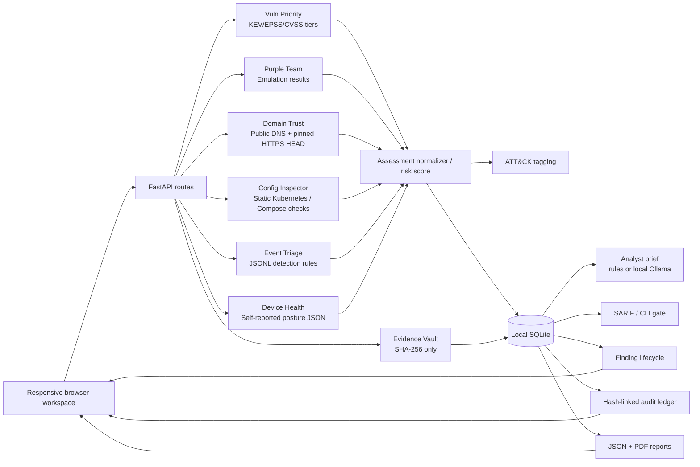

# SignalHarbor architecture and security boundaries

## Data flow

## Trust assumptions

- A single operator uses the service on localhost by default. Optional HTTP Basic authentication protects HTML/API access if configured. Production deployments require TLS, stronger identity, CSRF protection and deployment hardening.
- The domain check requires self-attested authorization. It validates all resolved addresses are globally routable, rejects mixed-address domains and pins HTTPS to a previously validated address. It issues one HEAD request to `/` without following redirects. It does not scan ports, exploit vulnerabilities, or scrape user data. There is no proof-of-ownership automation.
- IaC uploads are parsed with `yaml.safe_load_all`; they are not executed. Rules are explicitly heuristic and report possible problems for human review.
- Telemetry uploads contain timestamps and event labels; raw JSONL is discarded after summarization. Detection findings can include truncated identity identifiers.
- Device posture is an opt-in static JSON document. There is no ADB, USB bridge, extraction, surveillance agent or background collection.
- Evidence registration discards input file contents after computing SHA-256; it persists filename, label, size, hash, note and timestamp. The hash chain is internally consistent but not externally anchored or immutable.

- Vulnerability prioritization uses only fields in the uploaded export. KEV/EPSS enrichment is a separate script the operator runs; the server makes no outbound calls for it.
- Purple-team coverage analyses exercise *results*. SignalHarbor never executes techniques or payloads.
- ATT&CK mappings are related-technique context for analysts, not detections of adversary activity.
- The analyst brief sends only structured finding fields to an operator-configured local model. Upload-derived strings are sanitized and fenced as untrusted data, and the output is rendered as text. This is a mitigation, not a guarantee, against prompt injection.
- State-changing requests are rejected when cross-site (CSRF), domain checks are rate-limited, and non-loopback binds require a password.

## Local data model

`assets` → `assessments` (+ `details` JSON) → `findings` (+ `attack`)

`events`: operational messages; `artifacts`: metadata and SHA-256; `audit`: previous digest, payload fields, record digest.

Each assessment uses normalized severity: critical, high, medium, low, info. The latest assessment per asset determines the current Findings screen and cross-asset posture dashboard. The assessment archive preserves prior results for review. Resolved/accepted statuses apply to individual findings; rescanning creates fresh observations.

## Vulnerability priority rules

| Priority | SLA | Rule (first match wins) |
|---|---|---|
| P1 | 7 days | KEV and (internet-exposed or high/crown-jewel asset); or EPSS ≥ 0.5 and CVSS ≥ 7 and exposed |
| P2 | 30 days | KEV; or EPSS ≥ 0.1 and CVSS ≥ 7; or CVSS ≥ 9 on an exposed or crown-jewel asset |
| P3 | 90 days | CVSS ≥ 7 |
| P4 | 180 days | everything else |

Ranking within a tier: `risk = 100 × CVSS/10 × (0.4 + 0.6 × likelihood) × exposure(1.25) × criticality(0.6–1.2)`, where likelihood = max(EPSS, 0.97 if KEV). The thresholds are illustrative policy choices that an organization would tune; they are not a standard. SSVC and the CISA BOD 22-01 KEV deadlines are the closest real-world references.

## Constraints and design decisions

- File limits: 2 MiB static/config/device/event uploads, 5 MiB evidence uploads.
- DNS queries may time out; HTTPS HEAD may be rejected or redirect. Absence of a header on the `/` HEAD response is a narrow observation, not a claim about the whole app.
- No exploit execution, payload delivery, password attempts, stealth functionality, or extraction of private device content.
- No external analytics, API keys, CDNs, or trackers in the browser application.
- Sample assets are synthetic and always described as such in README and reports.

## Operational hardening roadmap

To deploy beyond a private demo, add OIDC/SAML, scoped roles, TLS, CSRF design, password lockout, rate limits, file parsing isolation, request quotas, malware checks on uploads, database backups, ledger signatures anchored to external trusted storage, job queues, structured metrics, and dedicated staging/security testing. This is not a production deployment checklist.
