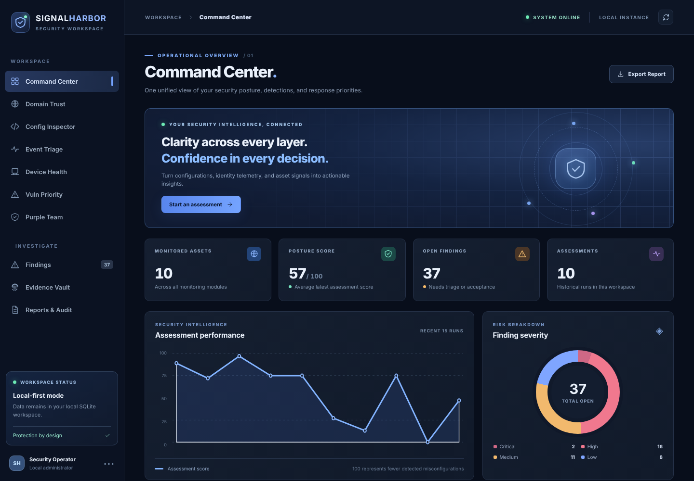
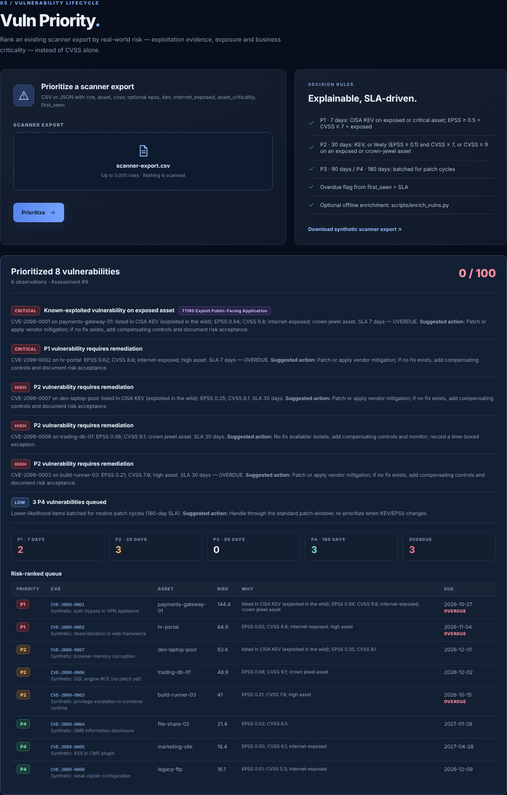
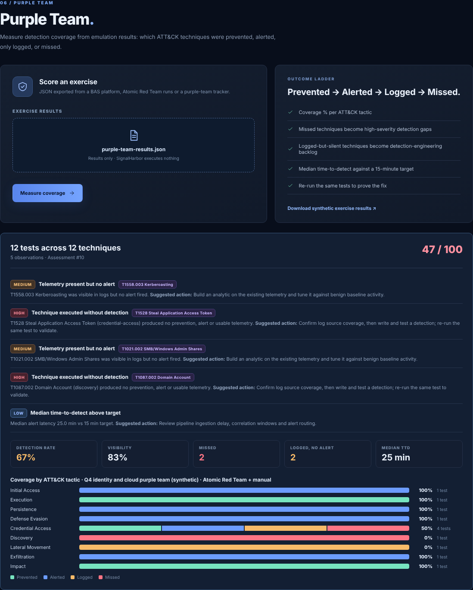
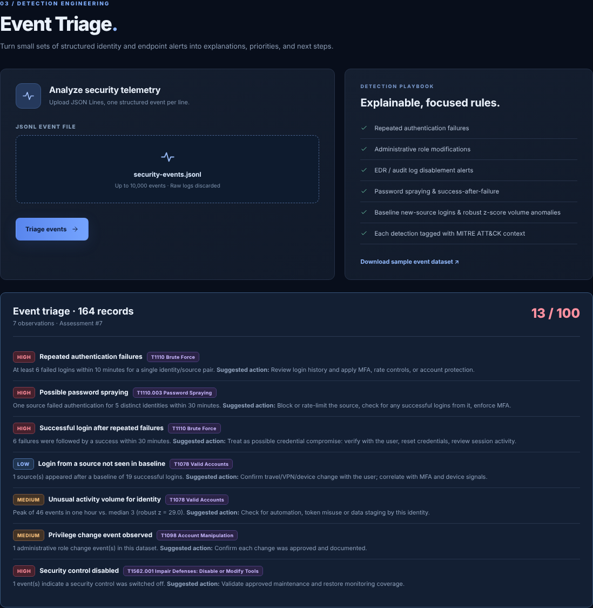
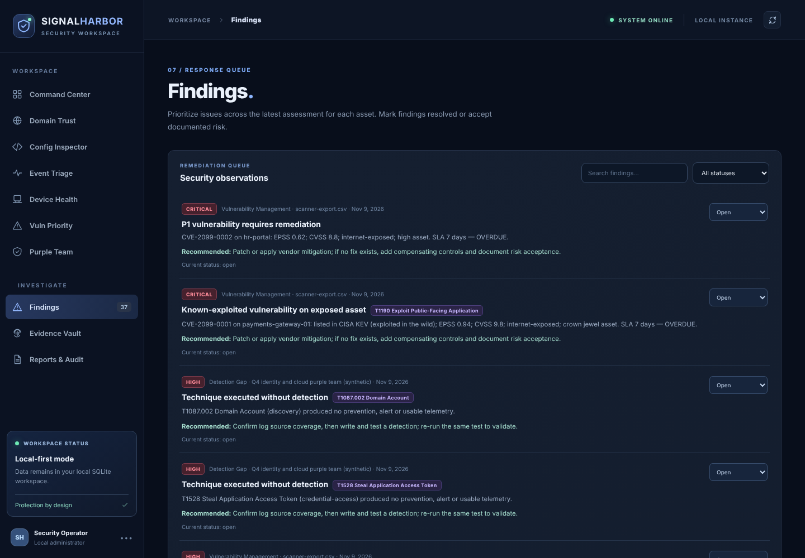
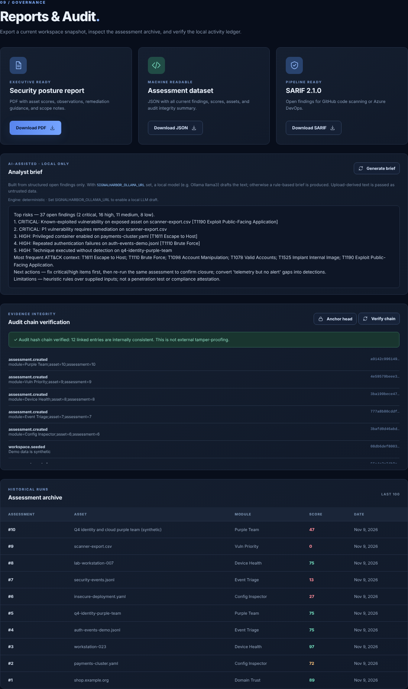
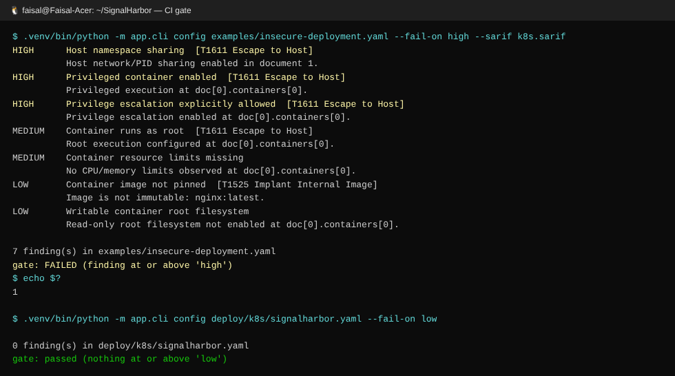
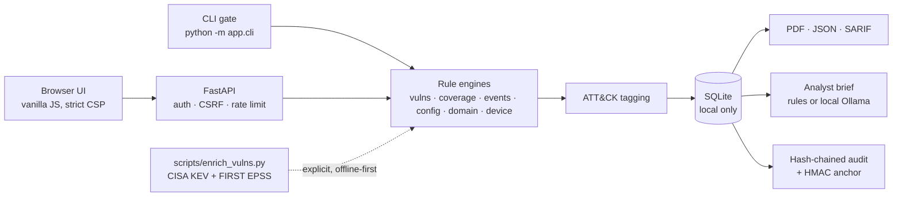

<div align="center">

# SignalHarbor

**A local-first security workbench for defenders and purple teams.**
Risk-based vulnerability prioritization · identity-log analytics · ATT&CK-mapped detection coverage · CI/CD security gates · a local-LLM analyst brief built to treat its inputs as hostile.

[](https://github.com/fa1829/SignalHarbor/actions/workflows/ci.yml)




</div>

> **Scope, stated up front:** SignalHarbor is a portfolio and lab project that runs on your own machine. It is **not** a SIEM, EDR, vulnerability scanner or breach-and-attack-simulation (BAS) platform, and it never executes attacks. It analyses data you already have, and every bundled dataset is synthetic.

---

## Contents

- [Why I built it](#why-i-built-it)
- [What it does](#what-it-does)
- [Screenshots](#screenshots)
- [Architecture](#architecture)
- [Quick start](#quick-start)
- [Using it](#using-it)
- [How the analytics work](#how-the-analytics-work)
- [Security design](#security-design)
- [Testing and CI](#testing-and-ci)
- [Project layout](#project-layout)
- [Limitations and roadmap](#limitations-and-roadmap)
- [About the author](#about-the-author)

---

## Why I built it

Security teams already hold the data they need: scanner exports, identity logs, deployment manifests and purple-team results. What's often missing is a fast, explainable way to answer three questions:

1. **Which vulnerabilities do we fix first?** CVSS alone answers "how bad could it be", not "how likely is it to be exploited here".
2. **Would we detect this attack?** A purple-team exercise is only useful if its results become a prioritized detection backlog.
3. **Can we stop risky changes before they ship?** The same rules should run in the browser and in the CI pipeline.

SignalHarbor answers each one with transparent rules. Every finding says *why*, carries MITRE ATT&CK context and can be exported for the next tool in the chain.

## What it does

| Module | Input | Output |
|---|---|---|
| **Vuln Priority** | Scanner export (CSV/JSON) | A P1–P4 remediation queue from **CISA KEV + EPSS + CVSS + internet exposure + asset criticality**, with SLA due dates, overdue flags and a written reason per item |
| **Purple Team** | Emulation results (BAS, Atomic Red Team, tracker) | Coverage per **ATT&CK tactic** on a prevented → alerted → logged → missed ladder, detection rate, visibility, median time-to-detect, and gaps turned into findings |
| **Event Triage** | JSONL identity/endpoint events | Sliding-window brute force, **password spraying**, **success after repeated failures**, **baseline new-source logins**, **robust z-score volume anomalies**, privilege changes, disabled controls |
| **Config Inspector** | Kubernetes / Docker Compose YAML | Privileged pods, host namespaces, root, `docker.sock`, unpinned images, missing limits. Parsed with `yaml.safe_load`, never executed |
| **Domain Trust** | A domain you are authorized to assess | SPF / DMARC / CAA / DS observations, HTTP security headers and TLS expiry from **one** pinned `HEAD` request |
| **Device Health** | Self-reported posture JSON | Disk encryption, patch age, EDR and backup hygiene |
| **Findings** | n/a | Triage workflow (open / resolved / accepted risk) with ATT&CK chips and search by technique ID |
| **Evidence Vault** | Any file | SHA-256 and metadata only; file bytes are discarded |
| **Reports & Audit** | n/a | Executive **PDF**, **JSON**, **SARIF 2.1.0**, an **analyst brief** (rule-based or local LLM), and a hash-chained audit ledger with an **HMAC-signed anchor** |

The same rules run headless as a **CI/CD gate**:

```bash
python -m app.cli config deploy/k8s/signalharbor.yaml --fail-on low --sarif k8s.sarif   # exit 0 pass / 1 fail / 2 input error
```

## Screenshots

| Vulnerability prioritization | Purple-team detection coverage |
|---|---|
|  |  |

| Identity-log analytics | Findings with ATT&CK context |
|---|---|
|  |  |

| Reports, SARIF, analyst brief, audit chain | CI gate in the terminal |
|---|---|
|  |  |

## Architecture



- **Local-first:** one process and one SQLite file. The web app makes no outbound calls except the domain check you ask for.
- **Threat intelligence on your terms:** KEV/EPSS enrichment is a separate script you run when you choose.
- **Same rules everywhere:** the UI, the API and the CLI call the same Python functions.

More detail: [ARCHITECTURE.md](ARCHITECTURE.md).

## Quick start

### Windows with WSL2 (recommended)

The step-by-step guide with screenshots is **[docs/WSL_DEPLOYMENT.md](docs/WSL_DEPLOYMENT.md)**. In short, inside Ubuntu:

```bash
git clone https://github.com/fa1829/SignalHarbor.git ~/projects/SignalHarbor
cd ~/projects/SignalHarbor
bash scripts/wsl-setup.sh          # installs, generates a random password, runs the tests
.venv/bin/python run.py            # then open http://localhost:8088 in Windows
grep PASSWORD .env                 # sign in as admin with this password
```

### Linux / macOS

```bash
bash scripts/wsl-setup.sh --no-apt   # needs Python 3.10+
make run
```

### Docker

```bash
export SIGNALHARBOR_PASSWORD='choose-a-long-unique-passphrase'
docker compose up --build            # non-root, read-only FS, caps dropped, bound to 127.0.0.1
```

### Kubernetes (lab cluster)

```bash
docker build -t signalharbor:1.1.0 .
kubectl create secret generic signalharbor-auth --from-literal=password='…'
kubectl apply -f deploy/k8s/signalharbor.yaml
kubectl port-forward svc/signalharbor 8088:8088
```

The manifest passes SignalHarbor's own gate at `--fail-on low`.

### Configuration (`.env`)

| Variable | Default | Purpose |
|---|---|---|
| `SIGNALHARBOR_USER` / `SIGNALHARBOR_PASSWORD` | `admin` / *(random from setup)* | HTTP Basic auth |
| `SIGNALHARBOR_HOST` / `SIGNALHARBOR_PORT` | `127.0.0.1` / `8088` | Bind address; a non-loopback bind requires a password |
| `SIGNALHARBOR_DB` | `./data/signalharbor.db` | SQLite location |
| `SIGNALHARBOR_AUDIT_KEY` | *(random from setup)* | HMAC key for audit-chain anchors |
| `SIGNALHARBOR_OLLAMA_URL` / `_MODEL` / `_TIMEOUT` | unset / `llama3` / `90` | Optional local LLM for the analyst brief |
| `SIGNALHARBOR_DOMAIN_RATE` | `10` | Domain checks per minute per client |

## Using it

Every module has a synthetic sample in [`examples/`](examples) and a *Download sample* link in the UI.

```bash
make scan                                                          # every module on the samples
python -m app.cli vulns    examples/scanner-export.csv             # ranked P1–P4 queue
python -m app.cli coverage examples/purple-team-results.json --json
python -m app.cli events   examples/security-events.jsonl
python scripts/enrich_vulns.py my-export.csv -o data/enriched.csv  # add live KEV + EPSS values
```

<details>
<summary><b>Input formats</b></summary>

**Scanner export (CSV or JSON):** `cve` and `cvss` are required. Optional fields: `asset`, `title`, `epss` (0–1), `kev` (bool), `internet_exposed` (bool), `asset_criticality` (`low|medium|high|crown_jewel`), `first_seen` (ISO date), `fix_available` (bool).

**Purple-team results (JSON):**
```json
{"exercise": "Q4 identity", "tool": "Atomic Red Team",
 "results": [{"technique_id": "T1110.003", "technique": "Password Spraying", "tactic": "credential-access",
              "test": "Spray 20 accounts", "prevented": false, "alerted": true, "time_to_detect_s": 240}]}
```

**Events (JSONL, one per line):**
```json
{"timestamp":"2026-11-08T10:05:00Z","event_type":"login_failed","user":"lab-user","ip":"198.51.100.12"}
```

**Device posture (JSON):** `device_id`, `disk_encrypted`, `screen_lock`, `patch_age_days`, `edr_running`, `backup_encrypted`.
</details>

<details>
<summary><b>REST API</b></summary>

| Method | Path | Purpose |
|---|---|---|
| GET | `/api/health` | Liveness (no auth) |
| GET | `/api/overview` | Assets, scores, severity counts, events |
| POST | `/api/vulns` · `/api/coverage` · `/api/events` · `/api/config` · `/api/device` | Multipart `file` upload → assessment |
| POST | `/api/domain` | `{"domain": "example.org", "authorized": true}` |
| GET / PATCH | `/api/findings` · `/api/findings/{id}` | List / set `open`, `resolved` or `accepted` |
| POST / GET | `/api/evidence` | Register a SHA-256 / list manifest |
| POST | `/api/ai/brief` | Analyst brief |
| GET | `/api/report.pdf` · `.json` · `.sarif` | Exports |
| GET | `/api/audit` · `/api/audit/verify` · `/api/audit/anchor` | Ledger, integrity check, signed head |

Interactive docs are at `/docs` (behind auth).
</details>

## How the analytics work

**Vulnerability priority:** tiered rules; the first match wins.

| Priority | SLA | Rule |
|---|---|---|
| P1 | 7 days | KEV on an exposed or high/crown-jewel asset; or EPSS ≥ 0.5, CVSS ≥ 7 and exposed |
| P2 | 30 days | KEV; or EPSS ≥ 0.1 and CVSS ≥ 7; or CVSS ≥ 9 on an exposed or crown-jewel asset |
| P3 | 90 days | CVSS ≥ 7 |
| P4 | 180 days | Everything else |

Within a tier, items are ranked by `risk = 100 × CVSS/10 × (0.4 + 0.6 × likelihood) × exposure × criticality`. The thresholds are illustrative policy, not a standard; SSVC and CISA BOD 22-01 are the closest real-world references.

**Identity analytics:**
- Brute force: ≥ 5 failures per identity/source within a 10-minute sliding window.
- Password spraying: one source failing against ≥ 5 identities within 30 minutes.
- Success after failures: ≥ 5 failures, then a success within 30 minutes. This is the "spray that worked" pattern.
- New source: an IP seen only after the first 70% of an identity's successful logins.
- Volume anomaly: a robust z-score (median / MAD, Iglewicz–Hoaglin 3.5 threshold) on hourly counts. Median/MAD is used because a burst inflates a standard deviation and hides itself.

**Purple-team coverage:** each test is classed as prevented, alerted, logged (telemetry but no alert) or missed. Missed tests become high-severity gaps, and logged-only tests become the detection-engineering backlog.

## Security design

| Control | Implementation |
|---|---|
| Exposure | Binds to `127.0.0.1`; `run.py` refuses a non-loopback bind without a password |
| Authentication | Optional HTTP Basic with constant-time comparison; `/docs` and `/openapi.json` also protected |
| CSRF | State-changing requests rejected when `Sec-Fetch-Site` is cross-site or `Origin` mismatches (browsers send Basic credentials automatically) |
| Browser hardening | CSP `script-src 'self'; style-src 'self'` with no inline code, `frame-ancestors 'none'`, nosniff, no-store, Permissions-Policy, COOP |
| Input handling | Size and row limits, `yaml.safe_load`, strict schema validation; raw logs and evidence bytes never stored |
| SSRF | Domain checks accept only globally routable IPs and pin TLS to the resolved address; the LLM endpoint comes from `.env` only |
| LLM safety | Only structured fields sent; upload-derived strings sanitized and fenced as untrusted data; output rendered as text and labelled an AI draft |
| Audit integrity | SHA-256 hash chain plus an HMAC-signed head (`/api/audit/anchor`) to store outside the machine |
| Abuse limits | Domain checks rate-limited per client |
| Supply chain | `pip-audit` and `bandit` in CI; container runs non-root with a read-only FS and all capabilities dropped |

**Honest limits:** the LLM controls *reduce* prompt-injection risk but cannot eliminate it. Anyone with write access to the database can rebuild the hash chain, which is why the anchor exists. Basic auth over plain HTTP is only acceptable on localhost.

## Testing and CI

```bash
make test    # 40 pytest tests
make lint    # ruff + bandit + pip-audit
```

The tests cover the priority rules (parametrized), coverage maths, each analytic, CSRF, rate limiting, auth on docs, the CLI exit codes, SARIF shape, LLM sanitization with a mocked model, rejection of non-HTTP model URLs, the v1.0 → v1.1 DB migration, offline enrichment, and a regression test for UI upload field names.

[`.github/workflows/ci.yml`](.github/workflows/ci.yml) runs lint, SAST, the dependency audit and the tests. It then **dogfoods the gate** on this repo's own Kubernetes and Compose files, proves a risky manifest is blocked, and uploads SARIF to GitHub code scanning.

## Project layout

```
app/
  main.py        FastAPI routes, auth, CSRF, CSP, rate limiting
  vulns.py       risk-based vulnerability prioritization
  coverage.py    purple-team coverage analysis
  checks.py      config / events / device / domain rules + identity analytics
  attack.py      MITRE ATT&CK mapping
  ai.py          analyst brief (rules or local Ollama) with injection controls
  sarif.py       SARIF 2.1.0 export
  cli.py         CI/CD gate
  db.py          SQLite, migrations, hash-chained audit
  reports.py     executive PDF
  static/ templates/   UI (no frameworks, no CDN, no inline scripts)
scripts/         wsl-setup.sh · wsl-service.sh · enrich_vulns.py
deploy/k8s/      hardened manifest that passes its own gate
docs/            WSL_DEPLOYMENT.md · INTERVIEW_DEMO.md · screenshots/
examples/        synthetic inputs for every module
tests/           pytest suite
```

## Limitations and roadmap

**Current limits:** single user and SQLite (one writer); Basic auth; heuristic rules; no sandboxed parser; YAML anchor/alias expansion is not yet capped; synthetic demo data.

**Next:**
- [ ] OIDC sign-in and roles (Microsoft Entra ID)
- [ ] An output check on the LLM brief: every finding it cites must exist in the input
- [ ] Power BI / Grafana feed for vulnerability trend dashboards
- [ ] Direct import of Atomic Red Team and Caldera result formats
- [ ] Cap YAML alias expansion; parse uploads in an isolated worker
- [ ] Postgres option for multi-user deployments

See [CHANGELOG.md](CHANGELOG.md) for release history, including the bugs fixed in v1.1.

## About the author

**Khandoker Faisal**: MASc in Information Systems Security (Concordia University), working on AI security, purple teaming and security automation. Formerly 16 years in mobile-network operations at a 55M-subscriber operator; co-inventor on a 5G/O-RAN DDoS defence patent application with Ericsson Canada.

[LinkedIn](https://linkedin.com/in/khandoker-faisal) · [GitHub](https://github.com/fa1829) · [Portfolio](https://faisal-tech.duckdns.org)

---

<sub>Educational and portfolio use. Assess only systems you own or are authorized to test. All sample data is synthetic; CVE IDs in the samples use the reserved-looking `CVE-2099-*` range so they cannot be mistaken for real advisories.</sub>
