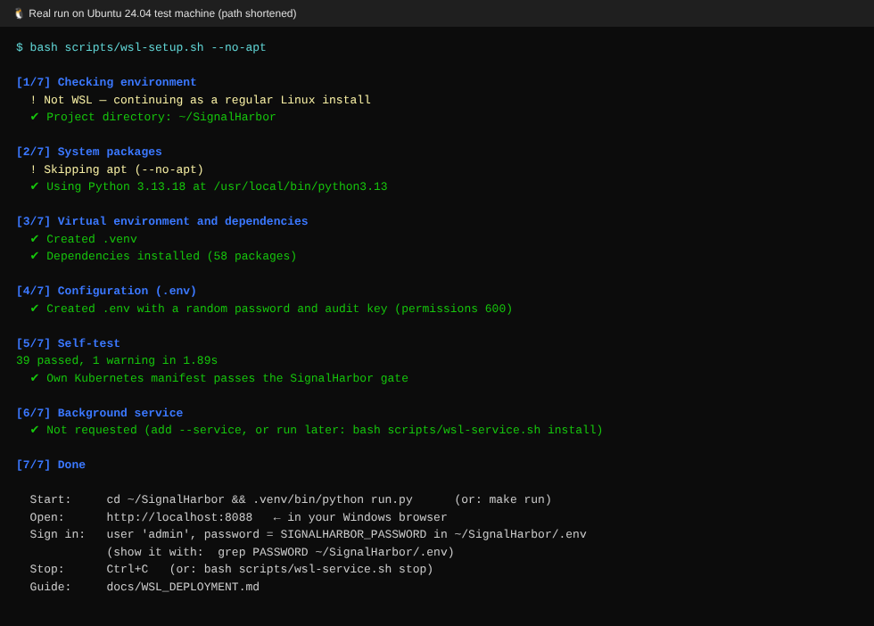
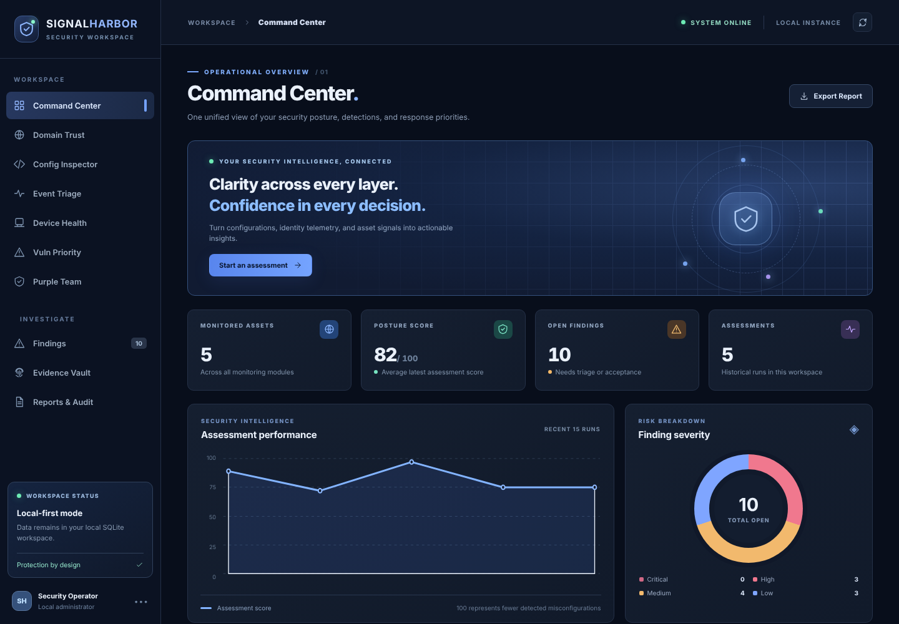
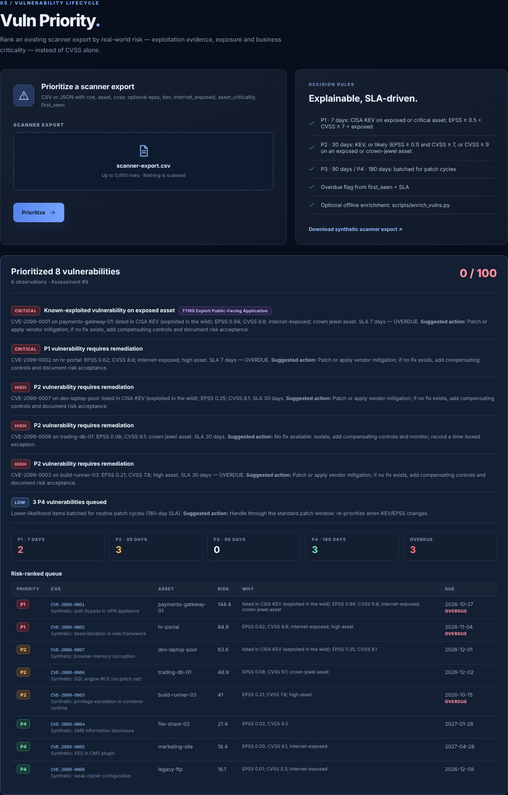
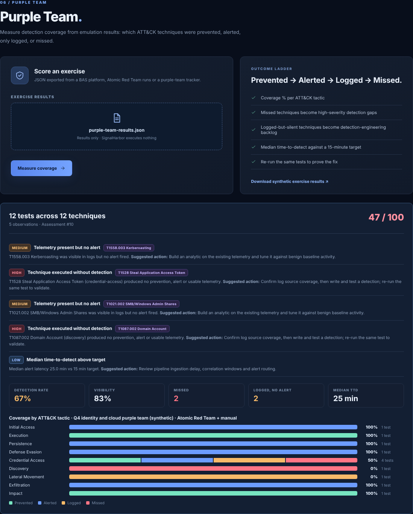
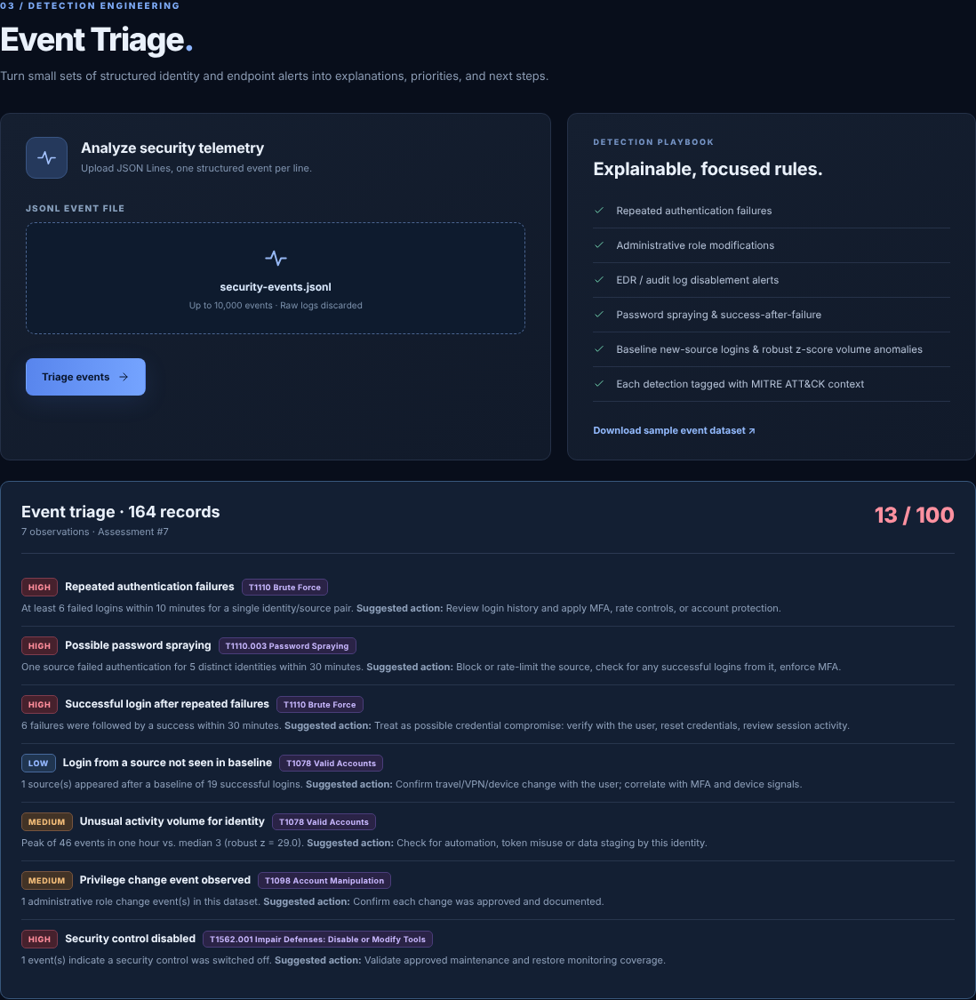
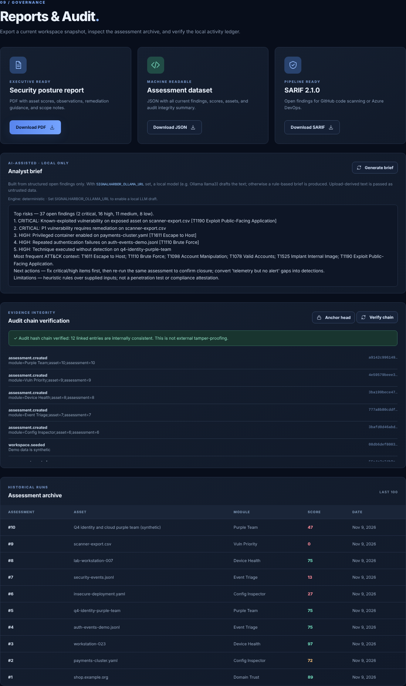
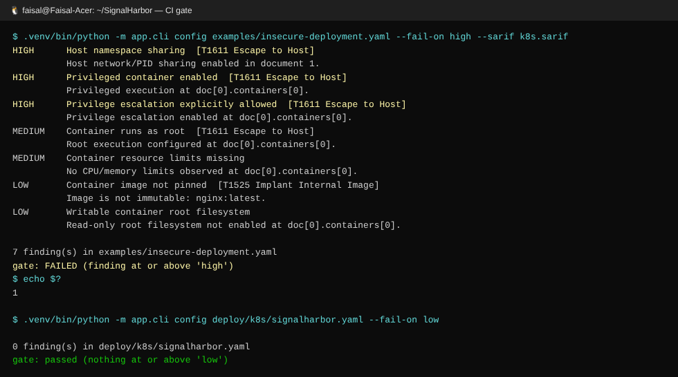

# Deploying SignalHarbor on Windows with WSL2: step by step

This guide goes from a Windows laptop with nothing installed to SignalHarbor running in Ubuntu on WSL2, opened in your Windows browser. Optional steps then cover running it as a background service, connecting your local Ollama model, Docker, and pushing to GitHub with CI.

**Time:** about 15 minutes. Most of that is the first `wsl --install`.
**You need:** Windows 10 (version 2004 or later) or Windows 11, an administrator account, and internet access.

> Every command block says where to type it. **PowerShell** means Windows PowerShell. **Ubuntu** means the WSL terminal.

---

## Step 1: Install WSL2 and Ubuntu 24.04

**PowerShell (Run as administrator):**

```powershell
wsl --install -d Ubuntu-24.04
```

Restart Windows when asked. Ubuntu opens by itself after the restart and asks for a **Linux username and password**. That password is for `sudo`; it is not your Windows password.

Check that the distribution is on WSL **version 2**:

```powershell
wsl -l -v
```

Expected:

```
  NAME            STATE           VERSION
* Ubuntu-24.04    Running         2
```

If VERSION shows 1, run `wsl --set-version Ubuntu-24.04 2`.

*Why 24.04:* it ships Python 3.12. On 22.04 the setup script installs `python3.11` for you instead.

---

## Step 2: Copy the project into your Linux home folder

Download `SignalHarbor_v1.1.zip` to your Windows **Downloads** folder.

**Ubuntu:**

```bash
sudo apt update && sudo apt install -y unzip
cp /mnt/c/Users/<YourWindowsUser>/Downloads/SignalHarbor_v1.1.zip ~
cd ~ && unzip -q SignalHarbor_v1.1.zip && cd SignalHarbor
ls
```

You should see `app/  docs/  examples/  scripts/  run.py  README.md …`

**Keep it in `~` (Linux), not `/mnt/c/...` (Windows).** Under WSL, files on the Windows drive are slower and can't hold Linux permissions, and the setup protects `.env` with `chmod 600`. If you run the script from `/mnt/c`, it copies the project to `~/SignalHarbor` and carries on from there.

*Tip:* to see these files from Windows Explorer, type `\\wsl$\Ubuntu-24.04\home\<linux-user>\SignalHarbor` in the address bar.

---

## Step 3: Run the setup script

**Ubuntu:**

```bash
bash scripts/wsl-setup.sh
```

The script runs 7 checked steps and is safe to re-run:

| Step | What it does |
|---|---|
| 1. Environment | Checks that it's running in WSL and that the folder isn't on the Windows drive |
| 2. System packages | `apt install python3 python3-venv python3-pip curl` (asks for your sudo password) and picks Python ≥ 3.10 |
| 3. venv + deps | Creates `.venv` and installs `requirements.txt` plus the test tools |
| 4. `.env` | Generates a **random password** and an **audit HMAC key**, then sets `chmod 600` |
| 5. Self-test | Runs the test suite, then runs SignalHarbor's own Kubernetes manifest through the CI gate |
| 6. Service | Only with `--service` (see step 7) |
| 7. Summary | Shows how to start, open and sign in |

Real output from a test run on Ubuntu 24.04. That machine was not WSL and apt was skipped, so lines 1–2 read differently from what you'll see:



Options: `--service` (also install the background service), `--no-apt`, `--dev` (lint/SAST tools), `--skip-tests`.

---

## Step 4: Start the app

**Ubuntu:**

```bash
cd ~/SignalHarbor
.venv/bin/python run.py        # or: make run
```

Expected:

```
SignalHarbor listening on http://127.0.0.1:8088  (auth: on, db: ./data/signalharbor.db)
INFO:     Uvicorn running on http://127.0.0.1:8088 (Press CTRL+C to quit)
```

Keep this terminal open. **Ctrl+C** stops the app.

---

## Step 5: Open it from Windows and sign in

In **Edge or Chrome on Windows**, go to **http://localhost:8088**. WSL2 forwards `localhost` from Windows into Linux automatically.

Your browser shows a sign-in box. The username is **admin**. To see the password, open a second Ubuntu tab and run:

```bash
grep PASSWORD ~/SignalHarbor/.env
```



The app starts with **synthetic** demo data, and every screen labels it that way.

---

## Step 6: Try every module with the bundled samples

Each module screen has a *Download sample* link. You can also upload the files from `~/SignalHarbor/examples/`.

| Screen | Upload | What you should see |
|---|---|---|
| Config Inspector | `insecure-deployment.yaml` | 7 findings (privileged pod, host namespaces, etc.), tagged **T1611 Escape to Host** |
| Event Triage | `security-events.jsonl` | 7 detections: brute force, **password spraying**, **success after failures**, **robust z-score volume anomaly**, new source, admin change, audit log disabled |
| Device Health | `device-posture.json` | 2 hygiene findings |
| **Vuln Priority** (new) | `scanner-export.csv` | A ranked P1–P4 queue with SLA due dates, OVERDUE flags and the reason for each priority |
| **Purple Team** (new) | `purple-team-results.json` | 67% detection rate, coverage bars per ATT&CK tactic, 2 missed and 2 "logged but no alert" gaps |
| Findings | n/a | Every finding with its ATT&CK chip. Search by technique (e.g. `T1110`) |
| Reports & Audit | n/a | PDF, JSON and **SARIF** exports, the **analyst brief**, **audit-chain verify and anchor** |






The same checks run headless, which is how CI uses them:

```bash
make scan                         # every module on the samples
.venv/bin/python -m app.cli config examples/insecure-deployment.yaml --fail-on high --sarif k8s.sarif
echo $?                           # 1 = gate failed, as intended
```



---

## Step 7 (optional): Run it in the background with systemd

**Ubuntu.** First check whether systemd is already running. Recent Ubuntu installs on WSL usually have it on.

```bash
ps -p 1 -o comm=          # prints "systemd" when enabled
```

If it prints something else, enable it:

```bash
sudo tee /etc/wsl.conf >/dev/null <<'EOF'
[boot]
systemd=true
EOF
```

Then in **PowerShell** run `wsl --shutdown` and reopen Ubuntu. Now install the service:

```bash
cd ~/SignalHarbor
bash scripts/wsl-service.sh install     # status | logs | restart | stop | uninstall
```

It runs as a **user** service (no root daemon) with `NoNewPrivileges`, `PrivateTmp` and `UMask=0077`. It starts whenever the Ubuntu distribution starts.

---

## Step 8 (optional): Refresh threat intel for Vuln Priority

This adds real CISA KEV status and FIRST EPSS scores to a scanner export of yours:

```bash
.venv/bin/python scripts/enrich_vulns.py my-export.csv -o data/my-export-enriched.csv
```

Then upload the enriched file. The web app itself never calls these feeds. You decide when to refresh them, which keeps the app's network behaviour predictable. *(The synthetic `CVE-2099-*` IDs in the sample are skipped.)*

---

## Step 9 (optional): Use your local Ollama model for the analyst brief

Without a model, **Reports → Analyst brief** produces a rule-based summary. To have your local model draft it instead, pick the option that matches your setup:

**A. Ollama on Windows + WSL "mirrored" networking (simplest on Windows 11 22H2+).** Create `C:\Users\<you>\.wslconfig`:

```ini
[wsl2]
networkingMode=mirrored
```

Run `wsl --shutdown` in PowerShell and reopen Ubuntu. After that, `localhost` inside WSL reaches Windows.

**B. Ollama on Windows, default NAT networking.** On Windows, set the user environment variable `OLLAMA_HOST=0.0.0.0` and restart Ollama. Allow inbound TCP 11434 for the WSL virtual network in Windows Firewall. Then, in Ubuntu, use the Windows host IP:

```bash
ip route show default | awk '{print $3}'     # e.g. 172.29.144.1 -> http://172.29.144.1:11434
```

**C. Ollama inside WSL.** Install it on Linux (`curl -fsSL https://ollama.com/install.sh | sh`), then `ollama pull llama3`.

Then add to `~/SignalHarbor/.env` and restart the app:

```bash
SIGNALHARBOR_OLLAMA_URL=http://localhost:11434     # or the IP from option B
SIGNALHARBOR_OLLAMA_MODEL=llama3
SIGNALHARBOR_OLLAMA_TIMEOUT=180                    # CPU-only inference is slow
```

Test it: `curl -s $SIGNALHARBOR_OLLAMA_URL/api/tags` should list `llama3`.
*Safety design:* only structured finding fields are sent. Upload-derived strings are sanitized and marked as untrusted data in the prompt. The model URL comes only from `.env`, and the output is rendered as plain text. See `app/ai.py`.

---

## Step 10 (optional): Docker instead of a venv

With **Docker Desktop**, turn on *Settings → Resources → WSL integration → Ubuntu-24.04*. Then, in **Ubuntu**:

```bash
export SIGNALHARBOR_PASSWORD='choose-a-long-unique-passphrase'
docker compose up --build        # or: make docker
```

The container runs non-root with a read-only filesystem, all capabilities dropped and `no-new-privileges`, and is published on `127.0.0.1:8088` only.

---

## Step 11 (optional): Put it on GitHub with CI

```bash
cd ~/SignalHarbor
git init && git add . && git commit -m "SignalHarbor v1.1"
git branch -M main
git remote add origin https://github.com/<you>/SignalHarbor.git
git push -u origin main
```

`.github/workflows/ci.yml` then runs on every push: **ruff** (lint), **bandit** (SAST), **pip-audit** (dependency CVEs) and **pytest**. It also gates the repo's own Kubernetes and Compose files with SignalHarbor, proves that a risky manifest gets blocked, and uploads SARIF to GitHub code scanning. `.env` and `data/` are git-ignored.

---

## Troubleshooting

| Symptom | Fix |
|---|---|
| `localhost:8088` doesn't load in Windows | Make sure `run.py` is still running. Run `wsl --shutdown`, reopen Ubuntu and start again. Or use mirrored networking (step 9A). Last resort: in `.env` set `SIGNALHARBOR_HOST=0.0.0.0` (a password is required) and browse to the IP from `hostname -I`. |
| `Address already in use` | Something else is on 8088: set `SIGNALHARBOR_PORT=8090` in `.env`. |
| Browser keeps asking for a password | Copy the value exactly from `grep PASSWORD .env`. To reset it, edit `.env` and restart. |
| `Refusing to listen on 0.0.0.0 without SIGNALHARBOR_PASSWORD` | This is deliberate. Set a password or bind to 127.0.0.1. |
| `ensurepip is not available` | `sudo apt install python3-venv` (or `python3.11-venv` on 22.04), then re-run setup. |
| Very slow installs, or permissions errors on `.env` | The project is under `/mnt/c`. Move it to `~` (step 2). |
| Brief always says "deterministic" | Run `curl $SIGNALHARBOR_OLLAMA_URL/api/tags` from Ubuntu. If it fails, go back to step 9 and check the networking option. |
| Time in the app looks wrong | The WSL clock drifted after sleep: `sudo hwclock -s` or `wsl --shutdown`. |
| Start over with clean data | `make clean-data` (asks first). This deletes your local database. |

## Uninstall

```bash
bash ~/SignalHarbor/scripts/wsl-service.sh uninstall   # if you installed the service
rm -rf ~/SignalHarbor
```
